<style>
  body { font-family: Calibri, "Segoe UI", Arial, sans-serif; font-size: 11pt; line-height: 1.45; }
  h1, h2, h3 { color: #0F4761; font-weight: normal; }
  h1 { font-size: 20pt; } h2 { font-size: 15pt; margin-top: 1.4em; } h3 { font-size: 12.5pt; }
  table { border-collapse: collapse; width: 100%; font-size: 9.5pt; margin: 0.4em 0 1em; }
  th { background: #DCE6F0; text-align: left; }
  th, td { border: 1px solid #BFBFBF; padding: 4px 6px; vertical-align: top; }
  tr { page-break-inside: avoid; }
  h2, h3 { break-after: avoid; page-break-after: avoid; }
  img, pre { break-inside: avoid; page-break-inside: avoid; }
  img { max-width: 100%; display: block; margin: 8px auto 2px; border: 1px solid #D9D9D9; }
  img.logo { border: 0; }
  .cover { text-align: center; padding-top: 40px; }
  .cover p { margin: 4px 0; }
  .caption { text-align: center; color: #595959; font-size: 9pt; margin-top: 2px; }
  .page-break { page-break-after: always; }
  .pendiente { background: #FFF4D6; border-left: 4px solid #C98A00; padding: 8px 10px; font-size: 10pt; }
</style>

<div class="cover">
  <p style="font-size: 14pt">INSTITUTO TECNOLÓGICO Y DE ESTUDIOS SUPERIORES DE OCCIDENTE</p>
  <br>
  <p style="font-size: 14pt">Tecnologías de desarrollo en el servidor</p>
  <br>
  
  <br><br><br><br>
  <p style="font-size: 14pt">Entrega 2: Roles y permisos</p>
  <br>
  <p>Presentan</p>
  <p>Emilio Daniel Guzmán Seda</p>
  <p>Daniel Sebastián Macías Macías</p>
  <p>Profesor: Francisco Javier Sevilla Medina</p>
  <br>
  <p>Fecha: viernes 30 de octubre de 2026</p>
</div>

<div class="page-break"></div>

# Recall — Roles y permisos

**Reporte de la entrega** · rama `dev_emi_three`, creada desde `main` · 30 de octubre de 2026

Este documento explica qué se hizo para implementar los roles y permisos de Recall, por qué se tomó cada decisión y cómo se comprobó. Complementa al documento del proyecto (`documentacion.pdf`), donde ya estaban definidos los roles y la matriz de permisos.

## Resumen

| Tema | Antes | Ahora |
| --- | --- | --- |
| Identidad en modo dummy | No se pedía token; cualquiera podía usar todas las rutas | Las rutas protegidas exigen `Authorization: Bearer <token>` en los dos modos |
| Roles | No existían | Campo `role` en User: `USER` (por defecto) o `ADMIN` |
| Autorización | Cualquier usuario autenticado podía leer y modificar todo | Se revisa el rol y el dueño del recurso en cada operación |
| Respuestas | 401 solo en modo cognito | 401 sin sesión válida y 403 sin permiso |
| Vistas | Públicas | Login con sesión en cookie; cada persona ve solo lo que le corresponde |
| Colección de Postman | 66 peticiones | 86 peticiones, con una carpeta nueva de Permisos |

## Roles

| Rol | Descripción |
| --- | --- |
| Invitado | Persona sin sesión. Solo puede registrarse, confirmar su correo, iniciar sesión y consultar `/health`. |
| Usuario (USER) | Rol por defecto al registrarse. Administra únicamente sus propias grabaciones, transcripciones y resúmenes. |
| Administrador (ADMIN) | Soporte y moderación: ve y administra los recursos de todos los usuarios y puede eliminar usuarios. |

## Matriz de permisos implementada

«Propios» significa que la acción solo se permite sobre recursos del mismo usuario; sobre los de otro responde 403.

| Acción | Invitado | Usuario | Admin | Dónde se aplica |
| --- | --- | --- | --- | --- |
| Registrarse, confirmar correo, iniciar sesión | Sí | Sí | Sí | Rutas públicas de `auth.routes.ts` |
| Ver su perfil (`GET /auth/me`) | No | Sí | Sí | Middleware `auth` |
| Listar usuarios | No | No | Sí | `requireRole("ADMIN")` |
| Ver usuario | No | Propios | Todos | `requireSelfOrAdmin` |
| Editar usuario | No | Propios | Todos | `requireSelfOrAdmin` |
| Eliminar usuario | No | No | Sí | `requireRole("ADMIN")` |
| Listar grabaciones | No | Propias | Todas | Filtro en `getRecordings` |
| Crear grabación | No | Sí (a su nombre) | Sí | `assertCanAccess` en `createRecording` |
| Ver, editar o eliminar grabación | No | Propias | Todas | `findRecordingOr404` |
| Procesar grabación | No | Propias | Todas | `findRecordingOr404` |
| Ver o editar transcripciones y resúmenes | No | De sus grabaciones | Todos | `findTranscriptionOr404`, `findSummaryOr404` |
| Crear o eliminar transcripciones y resúmenes | No | De sus grabaciones | Todos | `assertCanAccess` en cada controlador |
| Vistas web | No | Sus datos | Todos los datos | `viewAuth` y los mismos filtros |

## Qué se implementó

### 1. Campo `role` y migración

Se agregó el enum `UserRole` y el campo `role` al modelo User, con valor por defecto `USER`. La migración `20261030180000_add_user_role` es la cuarta del proyecto y solo agrega datos nuevos: los usuarios existentes quedan como `USER`, sin perder información.

```sql
CREATE TYPE "UserRole" AS ENUM ('USER', 'ADMIN');
ALTER TABLE "User" ADD COLUMN "role" "UserRole" NOT NULL DEFAULT 'USER';
```

En el seed, Sebastián Macías es `ADMIN` y los otros cinco usuarios son `USER`. Así el profesor puede probar los dos roles justo después de `npm run seed`.

### 2. Identificación del usuario

El middleware `auth` (`src/middlewares/auth.ts`) dejó de saltarse la validación en modo dummy. Ahora los dos modos siguen el mismo camino: toma el token, encuentra al usuario y guarda en `res.locals.user` su `id`, `email`, `name` y `role`.

| Modo | Token | Cómo se identifica al usuario |
| --- | --- | --- |
| `cognito` | Access token de Amazon Cognito | `aws-jwt-verify` valida firma y vigencia; se busca al usuario por `cognitoSub` |
| `dummy` | `dummy-<userId>`, lo devuelve `POST /auth/login` | Se busca al usuario por id; no se verifica contraseña |

El rol se lee de la base de datos en cada petición. Por eso un cambio de rol surte efecto de inmediato, sin volver a iniciar sesión.

### 3. Autorización

Se separó la autorización en dos piezas pequeñas para no repetir lógica:

- `src/middlewares/authorize.ts`: `requireRole("ADMIN")` y `requireSelfOrAdmin` protegen rutas completas.
- `src/lib/permissions.ts`: `currentUser`, `isAdmin` y `assertCanAccess` se usan dentro de los controladores, porque para saber quién es el dueño de una grabación primero hay que consultarla.

Los errores siguen pasando por el `errorHandler` central, así que 401 y 403 responden con el mismo formato JSON que el resto del API.

### 4. Reglas por recurso

- **Grabaciones:** para un usuario normal el listado siempre se filtra por su `userId`. Filtrar por otro usuario con `?userId=` responde 403.
- **Crear grabación:** `userId` ahora es opcional. Si no se envía, la grabación queda a nombre de quien la crea. Un usuario normal que envía el id de otro recibe 403; un administrador sí puede crearla para otro usuario.
- **Transcripciones y resúmenes:** no tienen dueño directo, así que el permiso se revisa con el dueño de su grabación.
- **Editar y eliminar:** antes se actualizaba directamente. Ahora primero se consulta el recurso para revisar al dueño, y un id inexistente sigue respondiendo 404.
- **Orden de validación:** primero 401 (quién eres) y 400 (datos válidos). En grabaciones, transcripciones y resúmenes sigue 404 (el recurso existe) y luego 403 (puedes usarlo). En `/users/:id` un usuario normal recibe 403 con cualquier id que no sea el suyo, exista o no.

### 5. Cambio de rol

El rol se cambia con `PATCH /users/:id` enviando `{ "role": "ADMIN" }`. Solo un administrador puede hacerlo: si un usuario intenta subirse el rol a sí mismo, recibe 403.

### 6. Sesión en las vistas

Un navegador no puede agregar el header `Authorization` al abrir una página, así que las vistas necesitaban su propia forma de iniciar sesión. Se agregaron `GET /login`, `POST /login` y `POST /logout`.

- Al iniciar sesión, el token se guarda en la cookie `recall_session`, con `httpOnly` (JavaScript no puede leerla) y `sameSite=lax`. En producción además lleva `secure`.
- Las rutas del API solo aceptan el header `Authorization`, no la cookie. Esto evita que otro sitio haga peticiones al API usando la sesión del navegador.
- Sin sesión, las vistas redirigen a `/login`. Una cookie inválida o vencida se borra y también redirige.
- La barra de navegación muestra el nombre y el rol, y oculta «Usuarios» a quien no es administrador.

### 7. Protección del modo dummy

En modo dummy cualquiera puede armar un token de administrador, porque no lleva firma. Sirve para desarrollo, pero sería un riesgo real en un servidor público. Por eso el API se niega a arrancar si `AUTH_MODE=dummy` y `NODE_ENV=production`.

### 8. Colección de Postman y CI

- La colección usa autenticación Bearer con las variables `{{adminToken}}` y `{{userToken}}`. Con `AUTH_MODE=cognito` se reemplazan por el `accessToken` de `POST /auth/login`.
- La carpeta nueva **Permisos** agrega 20 peticiones con los casos 401 y 403.
- El workflow `ci.yml` ahora inicia sesión antes de revisar las vistas, y comprueba que sin sesión redirijan.

## Archivos modificados

| Archivo | Cambio |
| --- | --- |
| `prisma/schema.prisma`, `prisma/migrations/20261030180000_add_user_role/` | Enum `UserRole` y campo `role` |
| `prisma/seed.ts` | Sebastián Macías queda como `ADMIN` |
| `src/middlewares/auth.ts` | Identificación por token en los dos modos; `viewAuth` para las vistas |
| `src/middlewares/authorize.ts` (nuevo) | `requireRole` y `requireSelfOrAdmin` |
| `src/lib/permissions.ts` (nuevo) | `currentUser`, `isAdmin` y `assertCanAccess` |
| `src/controllers/*.controller.ts` | Revisión de dueño y filtros por usuario |
| `src/routes/user.routes.ts`, `src/routes/view.routes.ts` | Permisos por ruta; login y logout |
| `src/schemas/*.schema.ts`, `src/models/*.model.ts` | `role` en PATCH; `userId` opcional al crear grabación |
| `src/config/env.ts` | Bloquea `AUTH_MODE=dummy` en producción |
| `src/app.ts`, `package.json` | `cookie-parser` |
| `views/login.hbs` (nuevo), `views/layouts/main.hbs`, `views/home.hbs`, `views/users/list.hbs`, `public/styles.css` | Login, sesión en la barra y rol en la lista de usuarios |
| `docs/api.postman_collection.json`, `.github/workflows/ci.yml`, `README.md`, `docs/documentacion.md` | Colección, CI y documentación |

## Pruebas y evidencia

Todas las pruebas de esta sección se corrieron el 30 de octubre de 2026 en una base PostgreSQL 17 desechable, con la migración aplicada y los datos del seed. Las imágenes de terminal son la salida real de los comandos, y las de las vistas son capturas del navegador con la aplicación en ejecución.

### Calidad y migraciones

El linter y TypeScript no reportan errores. `prisma migrate diff` confirma que la migración deja la base idéntica a `schema.prisma`.

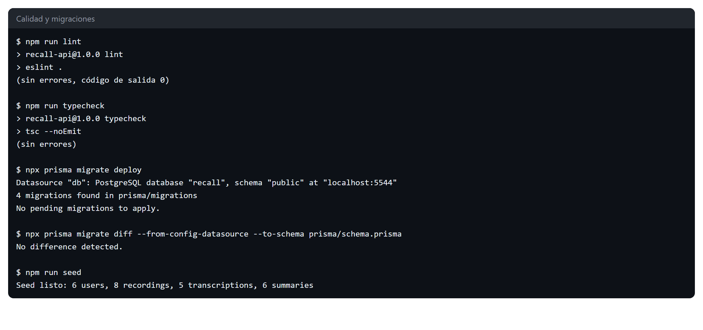

<p class="caption">Evidencia 1 · Lint, typecheck, migraciones y seed</p>

### Respuestas del API

Ejemplo de las respuestas del API: sin token responde 401; Ana (USER) recibe 403 en lo que no le corresponde, incluido cambiarse el rol; y Sebastián (ADMIN) sí puede ver la grabación de Ana.

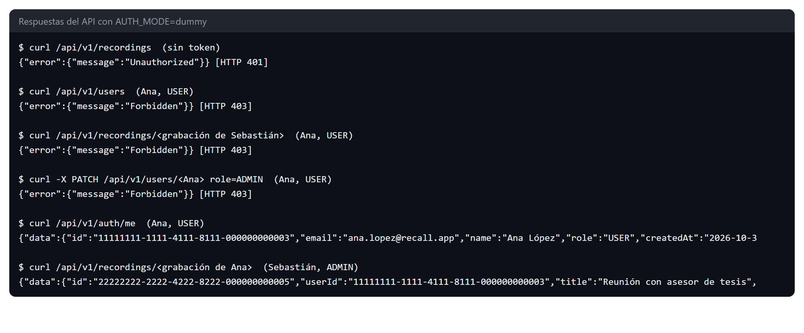

<p class="caption">Evidencia 2 · Respuestas 401, 403 y 200 con curl (modo dummy)</p>

### Colección de Postman

Corrieron las 86 peticiones con newman: 139 aserciones y ninguna falla. La imagen muestra la carpeta Permisos y el resumen de toda la colección.

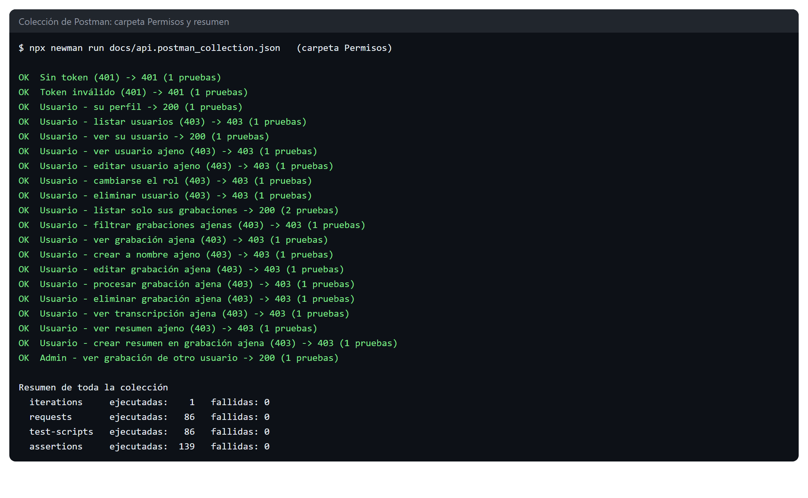

<p class="caption">Evidencia 3 · Colección de Postman con newman</p>

### Matriz de permisos completa

Un script recorre cada fila de la matriz como invitado, usuario y administrador, tanto en el API como en las vistas. Resultado: **107 verificaciones, 107 correctas**.

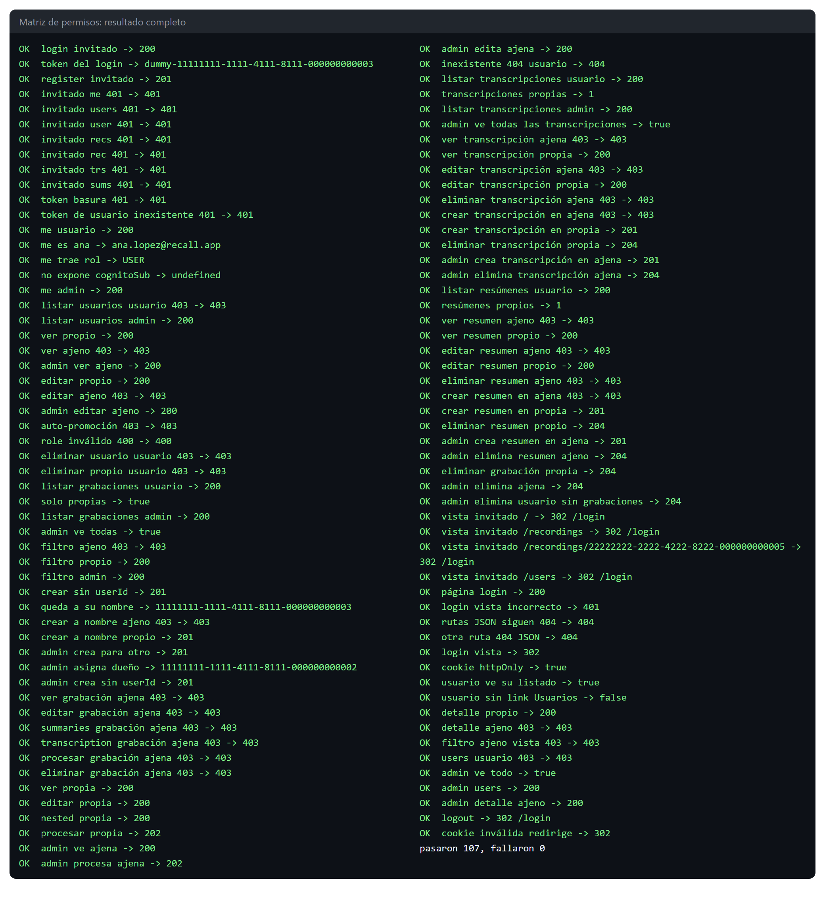

<p class="caption">Evidencia 4 · Verificación completa de la matriz de permisos (modo dummy)</p>

### Vistas como usuario normal

Ana López inicia sesión y solo ve sus 2 grabaciones. La barra no muestra «Usuarios» y aparece su nombre con su rol.

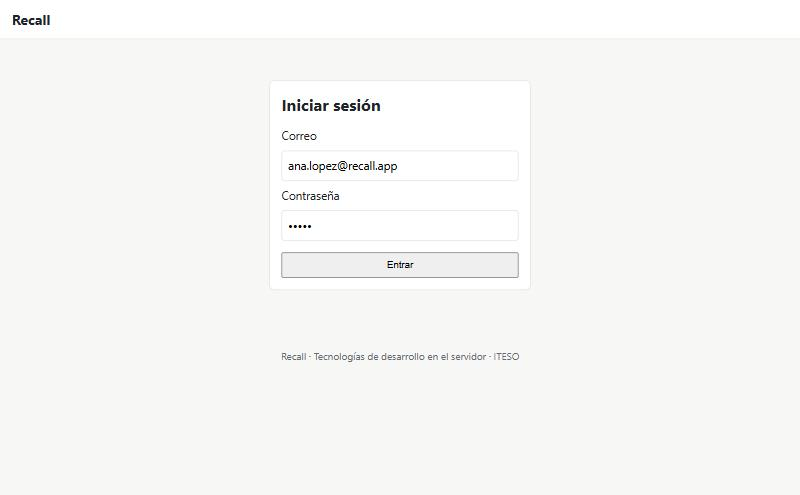

<p class="caption">Evidencia 5 · Inicio de sesión</p>

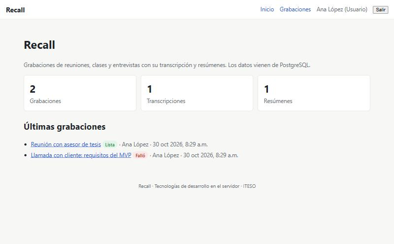

<p class="caption">Evidencia 6 · Inicio de Ana López: los conteos son solo de sus datos</p>

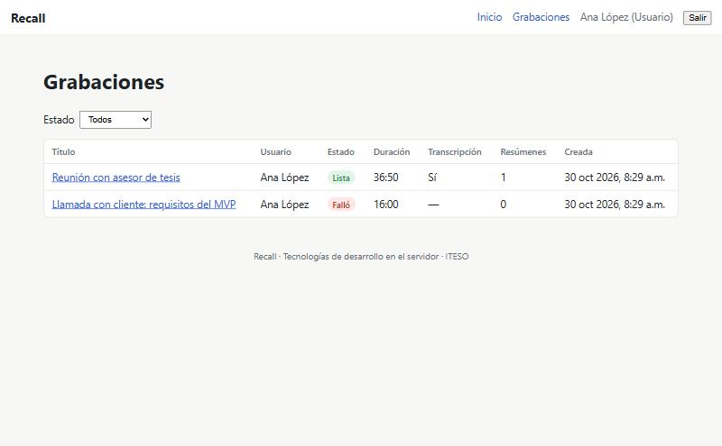

<p class="caption">Evidencia 7 · Grabaciones de Ana López: 2 de las 8 que existen</p>

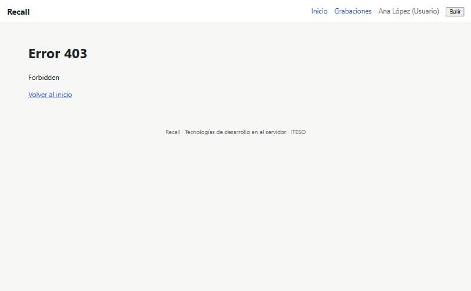

<p class="caption">Evidencia 8 · Ana López intenta abrir una grabación de Sebastián: error 403</p>

### Vistas como administrador

Sebastián Macías ve las 8 grabaciones, la lista de usuarios con su rol y el detalle de una grabación de otra persona.

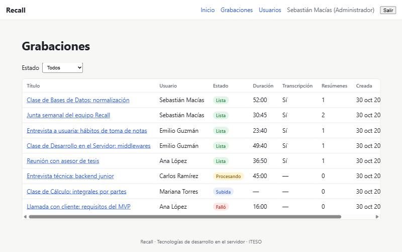

<p class="caption">Evidencia 9 · El administrador ve las grabaciones de todos</p>

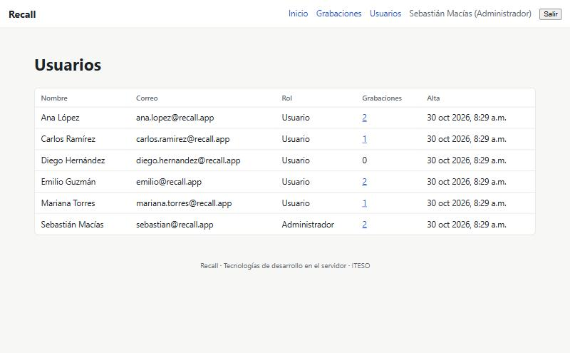

<p class="caption">Evidencia 10 · Lista de usuarios con su rol, solo para administradores</p>

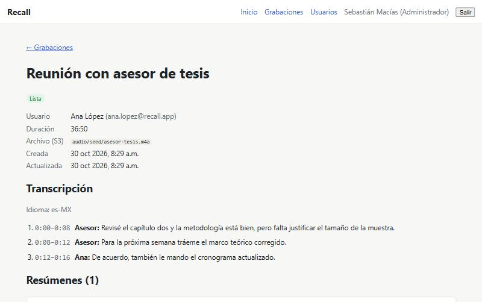

<p class="caption">Evidencia 11 · El administrador abre una grabación de Ana López</p>

## Estado de la prueba con Amazon Cognito

La prueba con el User Pool real quedó **parcial**. Se levantó el API con `AUTH_MODE=cognito` y la configuración real del proyecto, y se hizo todo lo que no necesita una contraseña.

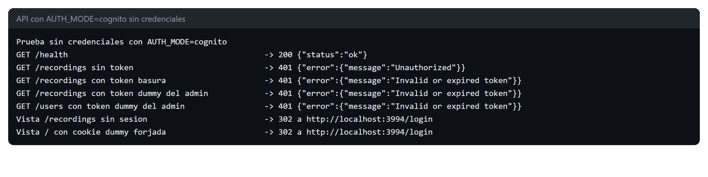

<p class="caption">Evidencia 12 · API en modo cognito: rechaza peticiones sin token, tokens falsos y tokens dummy</p>

| Comprobación | Resultado |
| --- | --- |
| El API arranca en modo cognito con la configuración real | Comprobado |
| Sin token responde 401 | Comprobado |
| Un token inválido responde 401 | Comprobado |
| Un token `dummy` del administrador se rechaza con 401 | Comprobado |
| Una cookie `dummy` falsificada no abre las vistas | Comprobado |
| Login real contra Cognito con la contraseña de un usuario | **Pendiente** |
| Validación de un access token real emitido por Cognito | **Pendiente** |
| Permisos USER y ADMIN usando un token real | **Pendiente** |
| Registro y confirmación de correo con una cuenta nueva | **Pendiente** |

<p class="pendiente"><strong>Pendiente:</strong> estas pruebas requieren iniciar sesión con una cuenta real del User Pool y las hará Daniel Sebastián Macías, que administra la cuenta de AWS. Las capturas de las vistas y las evidencias 2, 3 y 4 son del modo dummy. La lógica de permisos es la misma en los dos modos, porque solo cambia cómo se identifica al usuario a partir del token; esto se confirmará cuando terminen las pruebas pendientes.</p>

## Cómo reproducir las pruebas

```bash
npm ci
cp .env.example .env
docker compose up -d
npx prisma migrate deploy
npm run seed
npm run build && npm start
```

- **Vistas:** entrar a `http://localhost:3000/login` con `sebastian@recall.app` (ADMIN) o `ana.lopez@recall.app` (USER). En modo dummy la contraseña no se verifica.
- **API:** importar `docs/api.postman_collection.json` en Postman, o correr `npx newman run docs/api.postman_collection.json`.
- **Tokens:** `dummy-11111111-1111-4111-8111-000000000001` para ADMIN y `dummy-11111111-1111-4111-8111-000000000003` para USER.

## Consideraciones

- `npm run seed` vacía las tablas, así que borra a los usuarios registrados con Cognito. Se debe usar solo en desarrollo.
- Con `AUTH_MODE=cognito`, el primer administrador se asigna directamente en la base de datos, porque todavía no existe nadie que pueda otorgar el rol por el API.
- No se implementó una protección para evitar que el último administrador se quite el rol.
- Un administrador puede borrar a un usuario sin grabaciones, pero ese usuario sigue existiendo en Cognito.

## Próximos pasos

- Terminar las pruebas pendientes con Amazon Cognito.
- Login con Google como proveedor en Cognito.
- Documentación del API con Swagger.
