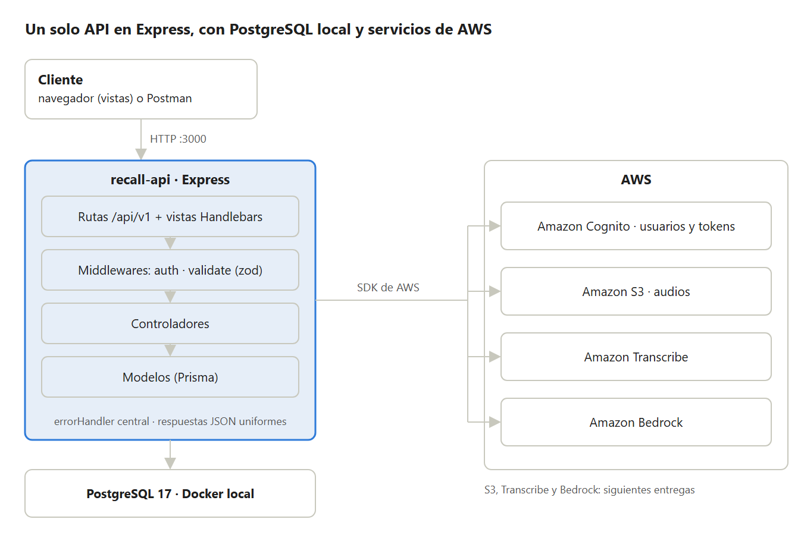
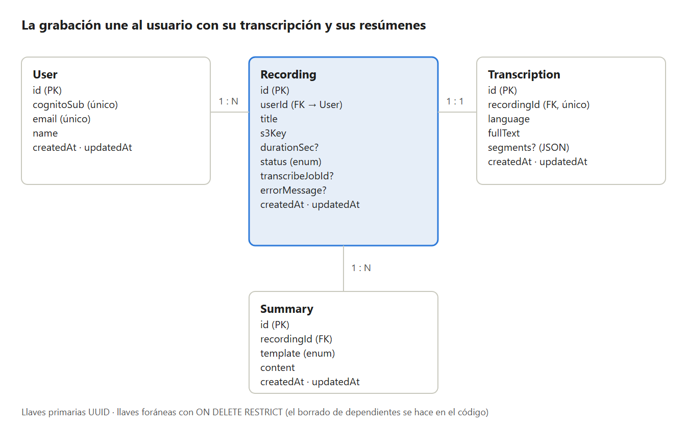

  
INSTITUTO TECNOLÓGICO Y DE ESTUDIOS SUPERIORES DE OCCIDENTE

   
  
Tecnologías de desarrollo en el servidor

   
  
      
  
Entrega 1: Persistencia de Datos (documento v2)

   
  
Presentan

  
Emilio Daniel Guzmán Seda

  
Daniel Sebastián Macías Macías

  
Profesor: Francisco Javier Sevilla Medina

   
  
Fecha: domingo 25 de octubre de 2026

# Proyecto Integrador — Recall

**Documento del proyecto · versión 2** · Entrega 1: Persistencia de datos · 25 de octubre de 2026

Recall es el REST API de una plataforma web que recibe audio de reuniones, clases y entrevistas, lo transcribe y genera resúmenes con IA, sin depender de un dispositivo dedicado. El MVP se mantiene lo más simple posible: un solo API en TypeScript con Express, PostgreSQL en Docker y servicios de AWS (Cognito, S3, Transcribe y Bedrock).

## Cambios respecto a la versión 1

| Tema | Versión 1 | Versión 2 (esta entrega) |
| --- | --- | --- |
| Persistencia | Endpoints con datos dummy | CRUD real con Prisma sobre PostgreSQL en los 4 modelos |
| Autenticación | JWT propio + bcrypt | Amazon Cognito (`AUTH_MODE=cognito`); modo dummy para probar sin AWS. La BD ya no guarda contraseñas |
| Modelo User | `passwordHash` | `cognitoSub` (único): liga al usuario de la BD con su identidad en Cognito |
| Borrado | Cascada en la base de datos | Llaves foráneas RESTRICT; los dependientes se borran en el código o se impide el borrado (409) |
| Validaciones | No había | Middleware `validate` con zod para body, params y query |
| Errores | Formato básico | `errorHandler` central que traduce errores de Prisma (P2002 → 409, P2025 → 404, etc.) |
| Nuevos entregables | — | Seed repetible, colección de Postman, vistas con Handlebars y CI/CD con GitHub Actions |
| Secciones nuevas | — | Requisitos del curso, Roles y permisos, Flujo de trabajo |

## Datos generales

| Campo | Valor |
| --- | --- |
| Nombre del proyecto | Recall |
| Tipo | REST API con TypeScript y Express, con vistas en Handlebars |
| Repositorio | github.com/sebastian0023/Recall (privado) |
| Acceso del profesor | fsevilla@gmail.com como colaborador |
| Materia | Tecnologías de desarrollo en el servidor · ITESO |

### Integrantes

| Nombre | Responsabilidades en esta entrega |
| --- | --- |
| Daniel Sebastián Macías Macías | Conexión a la BD, modelos y migraciones, CRUD con Prisma, validaciones con zod, manejo de errores y autenticación con Cognito |
| Emilio Daniel Guzmán Seda | Seed de la base de datos, vistas con Handlebars, colección de Postman, CI/CD (ESLint, SonarQube, Docker) y documento |

Ambos integrantes trabajan en ramas por funcionalidad que llegan a `develop` y luego a `main` mediante Pull Request.

## Descripción

### Problema

En reuniones, clases y entrevistas se pierde información porque tomar notas y prestar atención al mismo tiempo es difícil. Las herramientas que lo resuelven suelen requerir hardware de pago, están pensadas para el inglés o cobran suscripciones en dólares.

### Solución propuesta

Recall permite subir un archivo de audio. El API lo guarda en Amazon S3, lo transcribe con Amazon Transcribe y genera un resumen con Amazon Bedrock. El usuario consulta y edita sus grabaciones, transcripciones y resúmenes desde el API o desde las vistas web.

### Alcance del MVP

- Registro e inicio de sesión con Amazon Cognito.
- CRUD de grabaciones; el archivo de audio se guarda en S3.
- Transcripción en español con Amazon Transcribe.
- Resumen con Amazon Bedrock usando una de tres plantillas fijas: reunión, clase o entrevista.
- Consulta y edición de transcripciones y resúmenes, desde el API y desde vistas web.

### Esta entrega (Persistencia de datos)

- El API lee y escribe en PostgreSQL con Prisma; las migraciones están versionadas en `prisma/migrations`.
- Todo body, params y query se valida con zod antes de llegar al controlador.
- Los errores se responden desde un middleware central con un JSON consistente.
- `npm run seed` carga datos de prueba; `docs/api.postman_collection.json` tiene la colección de peticiones.
- Vistas con Handlebars: layout con navegación, listado y detalle de grabaciones con datos reales.

### Fuera del alcance

- Carpetas, etiquetas y plantillas personalizadas.
- Transcripción en tiempo real del audio, aplicación móvil y compartir grabaciones.
- Despliegue en la nube: el proyecto corre en local (la imagen Docker queda lista para un despliegue futuro).

## Proyectos similares y referencias

Recall toma como referencia principal a Plaud, pero elimina la dependencia de hardware y se enfoca en usuarios hispanohablantes.

| Referencia | Qué ofrece | Diferencia con Recall |
| --- | --- | --- |
| Plaud | Grabadoras físicas (Note, Note Pro, NotePin) de USD 159 a 189, con app que transcribe y resume con plantillas. Plan Pro de USD 17.99 al mes para 1,200 minutos. | Recall no requiere comprar un dispositivo: graba desde el navegador. |
| Otter.ai | Transcripción de reuniones y audios importados en 6 idiomas, con resúmenes y bot para Zoom, Teams y Meet. Plan gratuito limitado a 3 archivos importados. | Recall prioriza archivos subidos y grabación presencial, sin límite artificial de importaciones. |
| Fireflies.ai, tl;dv | Bots que se unen a videollamadas, transcriben y generan notas. | Enfocados en reuniones en línea; Recall cubre clases y entrevistas presenciales. |
| Grabadora de Google Pixel | Transcripción local en el teléfono. | Exclusiva de un modelo de teléfono y sin resúmenes por plantilla. |

### Motivo para desarrollar una herramienta similar

- **Sin hardware:** cualquier persona con navegador puede usarla, sin pagar un dispositivo de más de USD 150.
- **Español latino como prioridad:** plantillas y resúmenes pensados para contextos académicos y laborales en México.
- **Control de los datos:** el audio vive en un bucket propio, con políticas de retención definidas por el proyecto.
- **Fin académico:** integra autenticación, base de datos relacional, almacenamiento en la nube, contenedores y patrones de diseño.

## Stack de tecnologías

### Backend y base de datos

| Capa | Tecnología | Uso en el proyecto |
| --- | --- | --- |
| Lenguaje | TypeScript (strict) | Tipado estático |
| Runtime | Node.js 24 LTS | Ejecución del API |
| Framework HTTP | Express 5 | Rutas, middlewares, controladores y vistas |
| Base de datos | PostgreSQL 17 | Usuarios, grabaciones, transcripciones y resúmenes |
| ORM y migraciones | Prisma 7 | Esquema, migraciones versionadas y consultas tipadas |
| Validación | zod | Esquemas de body, params y query |
| Vistas | Handlebars (express-handlebars) | Layout, listado y detalle con datos de la BD |
| Contenedores | Docker Compose / Dockerfile | PostgreSQL local e imagen del API |
| Calidad y CI/CD | ESLint, SonarQube Cloud, GitHub Actions | Lint, quality gate, pruebas de la colección e imagen Docker en cada push |

### Librerías

| Librería | Para qué se usa | Entrega |
| --- | --- | --- |
| express, cors, dotenv | Servidor HTTP, orígenes permitidos y variables de entorno | Planeación |
| prisma, @prisma/client, @prisma/adapter-pg, pg | Esquema, migraciones y conexión a PostgreSQL | Planeación / Entrega 1 |
| zod | Validación de body, params y query | Entrega 1 (esta) |
| express-handlebars | Motor de vistas | Entrega 1 (esta) |
| @aws-sdk/client-cognito-identity-provider, aws-jwt-verify | Registro, login y verificación del access token de Cognito | Entrega 1 (esta) |
| eslint, typescript-eslint | Linter de TypeScript (también corre en CI) | Entrega 1 (esta) |
| tsx, typescript | Ejecución en desarrollo, seed y compilación | Planeación |
| multer, @aws-sdk/client-s3 | Recibir el audio y subirlo a S3 | Siguiente entrega |
| @aws-sdk/client-transcribe, client-bedrock-runtime | Transcribir y resumir | Siguientes entregas |

### Servicios de AWS

| Servicio | Uso |
| --- | --- |
| Amazon Cognito | Registro, confirmación por correo, login y emisión de tokens. Ya integrado (`AUTH_MODE=cognito`) |
| Amazon S3 | Guardar los archivos de audio en un bucket privado |
| Amazon Transcribe | Transcripción por lotes en español (es-US o es-MX) con separación de hablantes |
| Amazon Bedrock | Generar el resumen con un modelo de lenguaje a partir de la plantilla elegida |

### Alternativas investigadas

| Necesidad | Elegida | Alternativas |
| --- | --- | --- |
| Framework | Express | NestJS, Fastify |
| ORM | Prisma | TypeORM, Drizzle |
| Validación | zod | express-validator, joi |
| Vistas | Handlebars | EJS, Pug, cliente React separado |
| Transcripción | Amazon Transcribe | OpenAI Whisper, Deepgram, AssemblyAI |
| Resúmenes | Amazon Bedrock | OpenAI API, Ollama local |
| Almacenamiento | Amazon S3 | Cloudflare R2, MinIO |
| Autenticación | Amazon Cognito | JWT propio con bcrypt, Auth0 |

Se cambió de JWT propio a Amazon Cognito para no guardar contraseñas en la base de datos y para tener, con el mismo servicio, verificación por correo y login con proveedores externos (Google).

## Arquitectura

Arquitectura del MVP · un API en Express, PostgreSQL local y servicios de AWS

El API corre en la máquina del desarrollador, se conecta a PostgreSQL en Docker y usa el SDK de AWS. Sigue el patrón MVC:

- **Rutas** (`src/routes/`): definen los endpoints de cada módulo bajo `/api/v1` y las rutas de las vistas, y aplican los middlewares.
- **Middlewares** (`src/middlewares/`): `auth` (token de Cognito), `validate` (zod), `notFound` (404) y `errorHandler` (respuesta de error uniforme).
- **Controladores** (`src/controllers/`): reciben la petición validada, consultan la BD con Prisma y responden JSON o renderizan una vista.
- **Modelos** (`prisma/schema.prisma` y `src/models/`): esquema de la BD y tipos de entrada de cada entidad.
- **Vistas** (`views/`): plantillas Handlebars con un layout base y navegación.

### Flujo de procesamiento (siguientes entregas)

- `POST /recordings` recibe el audio, lo sube a S3 y crea la grabación con estado UPLOADED.
- `POST /recordings/:id/process` inicia un trabajo en Transcribe y cambia el estado a PROCESSING (hoy solo cambia el estado).
- Cuando el trabajo termina, el API guarda la transcripción, pide el resumen a Bedrock, lo guarda y cambia el estado a DONE (o FAILED si algo falla).

## Base de datos

La base de datos es relacional (PostgreSQL 17) con 4 tablas definidas en `prisma/schema.prisma`. Las llaves primarias son UUID y las migraciones están versionadas en `prisma/migrations`. El diagrama se actualizó respecto a la versión 1.

Diagrama entidad-relación actualizado · 4 tablas en PostgreSQL

### Relaciones

| Relación | Cardinalidad | Explicación |
| --- | --- | --- |
| User → Recording | 1 : N | Un usuario tiene muchas grabaciones; cada grabación pertenece a un solo usuario (`userId`). |
| Recording → Transcription | 1 : 1 | Una grabación tiene a lo más una transcripción; `recordingId` es único. |
| Recording → Summary | 1 : N | Una grabación puede tener varios resúmenes, por ejemplo uno por plantilla. |

### Índices y reglas

- Índices únicos: `User.email`, `User.cognitoSub` y `Transcription.recordingId`. Un duplicado responde 409.
- Índices de búsqueda: `Recording.userId` y `Summary.recordingId`.
- `Recording.status` es un enum: UPLOADED, PROCESSING, DONE, FAILED. `Summary.template` es un enum: MEETING, CLASS, INTERVIEW.
- Los fragmentos por hablante se guardan en un campo JSON (`segments`) para no crear una tabla extra.
- El audio no se guarda en la base de datos, solo su llave en S3 (`s3Key`).

### Política de borrado

Borrado físico resuelto en el código. Las llaves foráneas son RESTRICT, así que la base de datos nunca borra en cascada por su cuenta:

| Se elimina | Qué pasa |
| --- | --- |
| Recording | Se borran sus resúmenes y su transcripción y después la grabación, en una transacción. Responde 204. |
| User | Si tiene grabaciones no se elimina: responde 409. Primero hay que borrar sus grabaciones. |
| Transcription / Summary | Se eliminan directamente (no tienen dependientes). Responde 204. |

## REST API

Todas las rutas usan el prefijo `/api/v1` (excepto `/health` y las vistas). Las respuestas exitosas tienen la forma `{ data, message }` y los errores `{ error: { message, details? } }`.

### Endpoints

| Módulo | Método y ruta | Respuestas |
| --- | --- | --- |
| Health | `GET /health` | 200 |
| Auth | `POST /auth/register` | 201; 400; 409 correo duplicado |
| Auth | `POST /auth/confirm` | 200; 400 código inválido |
| Auth | `POST /auth/login` | 200 con accessToken; 401 |
| Auth | `GET /auth/me` | 200; 401 sin sesión |
| Users | `GET /users` · `GET /users/:id` | 200 (el detalle incluye sus grabaciones); 400; 404 |
| Users | `PATCH /users/:id` · `DELETE /users/:id` | 200 / 204; 400; 404; 409 correo duplicado o con grabaciones |
| Recordings | `GET /recordings` · `GET /recordings/:id` | 200 (incluyen user; el detalle, transcription y summaries); 400; 404 |
| Recordings | `GET /recordings/:id/summaries` · `/transcription` | 200 (rutas anidadas); 404 |
| Recordings | `POST` · `PATCH /:id` · `DELETE /:id` | 201 / 200 / 204; 400; 404 |
| Recordings | `POST /recordings/:id/process` | 202; 404 |
| Transcriptions | `GET` · `GET /:id` · `POST` · `PATCH /:id` · `DELETE /:id` | 200 / 201 / 204; 400; 404; 409 si la grabación ya tiene transcripción |
| Summaries | `GET` · `GET /:id` · `POST` · `PATCH /:id` · `DELETE /:id` | 200 / 201 / 204; 400; 404 |

Los listados aceptan filtros validados: `?status=&userId=` en recordings, `?recordingId=&template=` en summaries y `?recordingId=` en transcriptions.

### Validaciones y errores

- El middleware reutilizable `validate({ body, params, query })` corre antes del controlador con esquemas zod: obligatorios, tipos, longitudes, formatos (correo, UUID, código de idioma), rangos y enums. Un campo desconocido también es error.
- Una petición inválida responde 400 e indica en `details` qué campo falló y por qué.
- El `errorHandler` central traduce los errores de Prisma: P2002 → 409, P2025 → 404, P2003 → 409, P2023 → 400. Nunca responde con el stack ni con el código de la BD; ese detalle solo se escribe en la consola del servidor.
- Las rutas inexistentes responden 404 en JSON.

## Datos de prueba, colección y vistas

### Seed

`npm run seed` (`prisma/seed.ts`) limpia las 4 tablas y vuelve a cargar los mismos registros en una transacción, por lo que se puede correr varias veces sin errores ni duplicados: 6 usuarios, 8 grabaciones (con los 4 estados), 5 transcripciones y 6 resúmenes de las 3 plantillas. Los ids son fijos para que la colección de Postman funcione justo después del seed.

### Colección de peticiones

`docs/api.postman_collection.json`: 86 peticiones organizadas por módulo, con al menos una por endpoint y los casos de error (cuerpo inválido, id inexistente, id mal formado, duplicado, JSON mal formado, ruta inexistente, 401 y 403). La URL base está en la variable `{{baseUrl}}` y cada petición trae pruebas del status esperado, así que la colección completa se puede correr con newman.

### Vistas

| Ruta | Vista |
| --- | --- |
| `GET /` | Inicio: conteo de cada tabla y últimas grabaciones |
| `GET /recordings` | Listado de grabaciones con usuario, estado, duración y resúmenes; filtro por estado |
| `GET /recordings/:id` | Detalle: datos de la grabación, usuario, transcripción por hablante y resúmenes |
| `GET /users` | Listado de usuarios con su número de grabaciones |

## Requisitos del curso

Cómo cubre Recall cada requisito del curso y en qué entrega se implementa.

| Requisito | Cómo lo cubre Recall | Estado |
| --- | --- | --- |
| Base de datos | PostgreSQL 17 con Prisma: 4 tablas relacionadas, índices únicos y migraciones versionadas. | Hecho (esta entrega) |
| Validaciones | Middleware `validate` con zod para body, params y query; errores por campo con status 400. | Hecho (esta entrega) |
| MVC | Modelos (Prisma + tipos), vistas (Handlebars) y controladores, conectados por rutas por módulo. | Hecho (esta entrega) |
| Vistas | Handlebars: layout base con navegación, listado y detalle de grabaciones con datos reales. | Base hecha; se amplían en las siguientes entregas |
| Autenticación y permisos | Amazon Cognito para registro y login; el middleware `auth` verifica el access token. Permisos por rol (ver Roles y permisos). | Hecho (autenticación y permisos por rol) |
| Login con proveedor | Google como proveedor federado en Cognito (OAuth 2.0 con el Hosted UI). El usuario se crea o se liga por `cognitoSub`. | Entrega 2 |
| Correos | Cognito envía el código de verificación al registrarse. Con Amazon SES se avisará al usuario cuando su resumen esté listo. | Verificación hecha; aviso por correo pendiente |
| Archivos | Subida del audio con multer a un bucket privado de S3; la BD guarda solo `s3Key`. | Entrega 3 (archivos) |
| Servicio de terceros | Amazon Transcribe (transcripción) y Amazon Bedrock (resúmenes), además de Cognito y S3. | Cognito hecho; Transcribe y Bedrock pendientes |
| Tiempo real (websockets) | Socket.IO: el API emite el cambio de estado de una grabación (PROCESSING → DONE o FAILED) a la sala del usuario, para que la vista se actualice sin recargar. | Entrega posterior |

## Roles y permisos

El rol se guarda en el campo `role` (enum USER | ADMIN, por defecto USER) del modelo User. Después de `auth`, el middleware `authorize` y `src/lib/permissions.ts` revisan el rol y el dueño del recurso. Las vistas usan una sesión en cookie `httpOnly` con las mismas reglas. El rol solo lo cambia un administrador con `PATCH /users/:id`.

| Rol | Descripción |
| --- | --- |
| Invitado | Persona sin sesión. Solo puede registrarse, confirmar su correo, iniciar sesión y consultar `/health`. |
| Usuario (USER) | Rol por defecto al registrarse. Administra únicamente sus propias grabaciones, transcripciones y resúmenes. |
| Administrador (ADMIN) | Soporte y moderación: ve y administra los recursos de todos los usuarios y puede eliminar usuarios. |

### Matriz de permisos

«Propios» significa que la acción solo se permite sobre recursos del mismo usuario; sobre los de otro responde 403.

| Acción | Invitado | Usuario | Admin |
| --- | --- | --- | --- |
| Registrarse, confirmar correo, iniciar sesión | Sí | Sí | Sí |
| Ver su perfil (`GET /auth/me`) | No | Sí | Sí |
| Listar usuarios | No | No | Sí |
| Ver usuario | No | Propios | Todos |
| Editar usuario | No | Propios | Todos |
| Eliminar usuario | No | No | Sí |
| Listar grabaciones | No | Propias | Todas |
| Crear grabación | No | Sí (a su nombre) | Sí |
| Ver, editar o eliminar grabación | No | Propias | Todas |
| Procesar grabación (transcribir y resumir) | No | Propias | Todas |
| Ver o editar transcripciones y resúmenes | No | De sus grabaciones | Todos |
| Crear o eliminar transcripciones y resúmenes | No | De sus grabaciones | Todos |
| Vistas web | No | Sus datos | Todos los datos |

## Flujo de trabajo y CI/CD

- Ramas: `main` (lo que se evalúa), `develop` (integración) y ramas por funcionalidad (por ejemplo `auth_feature`, `develop_emi_two`). Nadie trabaja directo en main.
- Todo llega a develop y luego a main por Pull Request revisado por el otro integrante.
- El commit que se evalúa se etiqueta como `entrega-1` en main.

Los workflows de GitHub Actions corren en cada push y en cada Pull Request:

| Workflow | Qué revisa |
| --- | --- |
| `ci.yml` | ESLint; prisma validate, typecheck y build; con un PostgreSQL de servicio aplica las migraciones, corre el seed dos veces, arranca el API, corre la colección de Postman con newman y revisa que las vistas muestren datos. |
| `sonarqube.yml` | Análisis de SonarQube Cloud (bugs, code smells, duplicación y vulnerabilidades) con quality gate: si no pasa, el workflow falla. |
| `docker.yml` | Construye la imagen del API; en push a develop o main la publica en GitHub Container Registry. |

## Consideraciones

### Seguridad y privacidad

- Las grabaciones contienen voces y datos personales, por lo que aplica la Ley Federal de Protección de Datos Personales en Posesión de los Particulares (LFPDPPP).
- El usuario debe contar con el consentimiento de las personas grabadas.
- La base de datos no guarda contraseñas: las administra Amazon Cognito. Las respuestas nunca exponen `cognitoSub` ni detalles internos.
- El bucket de S3 será privado. Las credenciales solo viven en el `.env`, que está en `.gitignore`; `.env.example` no tiene valores secretos.

### Costos

- Cognito tiene capa gratuita para el volumen del proyecto. S3, Transcribe y Bedrock cobran por uso: se configurará una alerta de AWS Budgets y una duración máxima de audio.
- GitHub Actions y SonarQube Cloud son gratuitos para este uso.

### Próximos pasos

| Entrega | Pendientes |
| --- | --- |
| Entrega 2: autenticación | Login con Google en Cognito y documentación del API con Swagger. |
| Entrega 3: archivos | Subida de audios con multer a S3. |
| Entregas siguientes | Transcripción con Amazon Transcribe, resúmenes con Amazon Bedrock, aviso por correo con SES, websockets con Socket.IO, paginación y filtros. |
